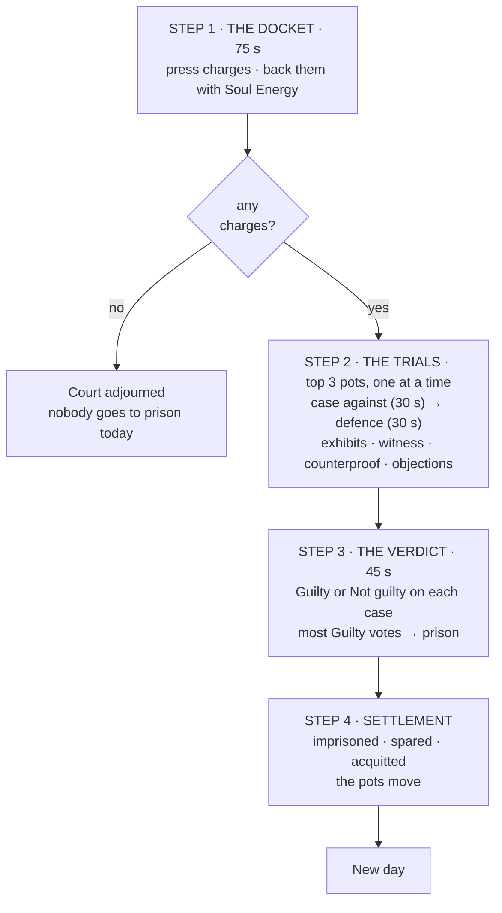

# The Trial — the Consultation procedure

> **⚠ Superseded for building by [`trial-build-spec.md`](trial-build-spec.md) (2026-11-05).** Changes there: only **one** defendant per day (most Soul Energy backed in total), a single Guilty / Not guilty verdict (guilty = imprisoned, not guilty = spared), and new counterproof objection rules. Use this file for background, examples and side effects only.


**Status:** final design, not built. 2026-11-04.
**This version:** every step written out in full, with examples of proof and
counterproof. Small additions: each trial is split into a prosecution half and a
defence half; defendants can't vote on their own case; the court record keeps
dead players' history.

Numbers marked *(tunable)* are starting values for playtesting.

**Contents**
- Part 1 — The procedure, step by step
  - Before the steps: who can do what · the two kinds of proof
  - Step 1 · The Docket
  - Step 2 · The Trials
  - The proof catalogue
  - What good proof looks like, by charge
  - Step 3 · The Verdict
  - Step 4 · Settlement
  - The court record and reputation
  - A full day in court
- Part 2 — Side effects
- Part 3 — Building it

---

## The idea in one line

> **Soul Energy rewards persuading the room. The win condition rewards being right.**

Every payout depends on how the room votes, so the only way to earn in court is to
convince people out loud. Nothing is settled on truth, so the court never reveals
anyone's camp — unless a player pays to object to a specific piece of proof.

## The procedure at a glance



**The slide for the how-to-play deck:**

> **Press a charge** — *Vice*, *Murder* or *False witness* — and **back** charges with Soul Energy. The three biggest pots go to trial.
> **Prove it** — File proof. It can be real or forged. Each defendant calls one witness, who can file counterproof.
> **Object!** — Think something's forged? Pay to challenge it. The court rules on the spot.
> **Verdict** — Vote Guilty or Not guilty on each case. **Most Guilty votes goes to prison.**
> **Imprisoned:** the prosecution doubles its money. **Acquitted:** the defendant and their witness take the pot.

---

# Part 1 — The procedure, step by step

## Before the steps: who can do what

| | Alive | In hospital | In prison | Dead |
|---|---|---|---|---|
| Press, back, file exhibits, object | ✓ | — | — | — |
| Be charged | ✓ | ✓ | — | — |
| Be called as a witness, file counterproof | ✓ | ✓ | ✓ | — |
| Vote | ✓ (not on your own case) | — | — | — |
| Watch everything | ✓ | ✓ | ✓ | ✓ — and see which exhibits are genuine |

The **court record** is one tap away on every screen, from the first second of the
phase to the last.

## Before the steps: the two kinds of proof

| | **Public evidence** | **Exhibits** |
|---|---|---|
| What it is | Facts the game shows everyone: each player's Quiz decision and Outreach contacts, every day | Private information a player puts in front of the court |
| Cost | Free — always on screen | 50 SE |
| Can it be fake? | No | Yes — genuine and forged look identical |
| Can it be challenged? | No | Yes — anyone can object |
| Example | "The record shows Bob took *points* on day 2." | "Day 2 — I peeked at Bob. He is a **Vice**." |

Public evidence is how you catch an impossible story: if Bob says he peeked at Carl
on day 2, everyone can see he took points that day. Exhibits are how you put
something nobody else knows in front of the room — and risk being caught.

---

## Step 1 · The Docket

**Time:** 75 s *(tunable)*. Majority-advance: when most players press **Done**, the
usual 10 s countdown starts.

### 1.1 What you see

The Council Vote stinger plays, then the Docket opens:

- **Top:** *"THE DOCKET — press and back charges. The three biggest pots go to trial."*
  The countdown, and your Soul Energy.
- **Middle:** the live docket. Every charge is a row: defendant, charge, victim (for
  Murder), pot, and every backer with their amount. Each row has a **Back +25** button.
- **Feed:** *"Anna pressed a charge: Bob — Vice — 50."* · *"Dana backed Bob — Vice — 50."*
- **Bottom:** **Press a charge** · **Done** · the **Court record** tab.

### 1.2 Pressing a charge, tap by tap

1. Tap **Press a charge**.
2. Choose the **defendant** — any living player who isn't in prison, except you.
3. Choose the **charge**. Only the charges you can press against that player are offered:
   - **Vice** — always.
   - **Murder** — only if someone has died since the last trial. You then choose the
     victim from those deaths.
   - **False witness** — only if that player messaged you in today's Outreach.
4. Choose your **stake**: 25, 50, 75 or 100 SE.
5. **Confirm.** The charge joins the docket with your name and stake, and the feed
   announces it.

Rules:
- One press per player per day.
- If the exact charge already exists (same defendant, charge and victim), your stake
  **backs** it instead and doesn't use up your press.
- You can't charge yourself.

### 1.3 The three charges — when you'd press each

**Vice — "Bob is a Vice."**
The everyday charge. Press it when you believe a player is on the Vice side —
because your Quiz peek said so, because their story doesn't match the record, or
because someone you trust told you.
> *"I peeked at Bob on day 2. He's a Vice. I'm putting 50 on it."*

**Murder — "Bob killed Eli."**
Press it when someone has died since the last trial and you think you know who did
it. Murder is not the same as Vice: Justice and Sacrifice are Virtues who kill, and
anyone can buy a kill potion. It lets the room argue about one death specifically.
> *"Eli told me yesterday that Bob was threatening him. Eli's dead. 25 on Bob for murder."*

**False witness — "Carl told me something false."**
Press it when a player messaged you today and you believe what they said was untrue.
Only the person who received the message can press it; anyone can back it.
> *"Carl told me in Outreach that Dana is a Vice. I don't believe it — I want him to
> explain it in front of everyone."*

### 1.4 Backing a charge

- Tap **Back +25** on any row, except a charge against you. Tap again to add more.
- Your total on one charge — including a stake you pressed with — is capped at
  **100 SE** *(tunable)*. You can back as many different charges as you like.
- **Backing can't be withdrawn.**
- Your name and amount appear on that row straight away.

### 1.5 How a docket moves — an example

**After 10 s**
> Bob — Vice — **50** · Anna 50

**After 40 s** — people start recruiting out loud
> Bob — Vice — **125** · Anna 50 · Dana 50 · Fay 25
> Anna — Vice — **50** · Hana 50
> Carl — False witness — **25** · Gus 25

**At the close**
> Bob — Vice — **125** · Anna 50 · Dana 50 · Fay 25
> Anna — Vice — **100** · Hana 50 · Carl 50
> Carl — False witness — **25** · Gus 25
> Hana — Murder (Eli) — **25** · Fay 25
> Bob — Murder (Eli) — **25** · Dana 25

### 1.6 Closing the docket

1. Each defendant is represented by their **biggest pot**. Every other charge against
   the same defendant is refunded.
2. The **three biggest pots** go to trial *(tunable)*.
3. Ties: more backers goes first, then whichever charge was pressed earliest.
4. Every charge that isn't tried is **refunded in full**, immediately.

Applied to the example: Bob's Murder charge (25) is refunded to Dana, because Bob's
Vice charge (125) is bigger. Carl's and Hana's charges tie at 25 with one backer
each; Gus pressed before Fay, so Carl goes to trial and Fay is refunded. The screen:

> **THE COURT WILL HEAR**
> 1 · Bob — Vice — 125
> 2 · Anna — Vice — 100
> 3 · Carl — False witness — 25
> *Refunded: Dana 25 (Bob — Murder) · Fay 25 (Hana — Murder)*

### 1.7 No charges

> *"No charges were pressed. The court is adjourned. Nobody goes to prison today."*

The phase goes straight to the new day.

---

## Step 2 · The Trials

### 2.1 Order and timing

Trials run **one at a time**, biggest pot first. Each trial has two halves:

| Half | Time | Banner | What it's for |
|---|---|---|---|
| **The case against** | 30 s *(tunable)* | *THE PROSECUTION HAS THE FLOOR* | The prosecution files exhibits and makes its case |
| **The defence** | 30 s *(tunable)* | *THE DEFENCE HAS THE FLOOR* | The witness testifies, counterproof is filed, the defendant answers |

- **The defence always speaks last.** No new prosecution exhibits in the second half.
- **Every new exhibit or counterproof adds 10 s** to the half it was filed in — at most
  +30 s per trial — so nothing can be slipped in at the buzzer without a chance to object.
- **Majority Done** ends a half early.

### 2.2 What you see

- **Top:** *"BOB IS ON TRIAL — charged with being a Vice"*, the pot, the prosecutors,
  which half it is, and the countdown.
- **Exhibits:** each one a numbered card — **P1, P2…** for the prosecution, **D1** for
  the defence — so people can refer to them out loud ("look at P2!").
- **Side:** the defendant's entry in the court record, and their reputation.
- **Feed:** exhibits filed, witness called, accepted or refused, objections and rulings.
- **Bottom:** the actions open to *you*.

An exhibit card:

```
P1 · PROSECUTION · filed by Anna · 50 SE
QUIZ · DAY 2 · PEEK
"I peeked at Bob. He is a Vice."
                                   [ Object — 50 SE ]
```

### 2.3 First half — the case against

| Who | Can |
|---|---|
| Anyone eligible, except the defendant and their witness | **File an exhibit** — 50 SE, one per player per trial. It goes into the pot |
| The defendant | **Call the witness** already now (recommended: it gives the witness time) · **object** |
| Everyone eligible | **Object** |

Out loud, the prosecutors make their case: what they believe, and why they put money on it.

### 2.4 Second half — the defence

| Who | Can |
|---|---|
| The witness | **Accept or refuse** (if not done yet) · file **one counterproof**, 50 SE |
| The defendant | **Speak** · call the witness, if they haven't · **object** |
| Everyone eligible | **Object** |
| Prosecution | Object — but no new exhibits |

### 2.5 Calling a witness

1. The defendant taps **Call a witness** and picks any living player who has **no stake**
   in this charge — didn't back it, didn't file an exhibit on it. Players in hospital
   and in prison can be called.
2. The witness's phone: *"BOB CALLS YOU AS A WITNESS"* — **Accept** · **Refuse**, with a
   **15 s** timer *(tunable)*. A pending call holds the half open until it's answered.
3. Every screen: *"Bob calls Carl as a witness…"* → *"Carl accepts."* or
   *"Carl refused to testify."* No answer counts as refusing.
4. A witness who accepts may file **one counterproof** (50 SE) — real or forged — or
   simply speak.
5. **One call per trial.** There's no second chance.

**What's in it for the witness:** if the defendant is acquitted, the witness takes
**half the pot** and their counterproof back **×2**. If the defendant is imprisoned, the
witness loses only their counterproof.

### 2.6 What a defendant can and can't do

- **Speak** — the main thing.
- **Call one witness.**
- **Object** to prosecution exhibits — including ones about themselves. Careful:
  objecting to a genuine exhibit confirms it in front of everyone.
- **Can't file exhibits.** A defendant's own evidence can only be said out loud — or
  filed by a witness who holds it themselves.

### 2.7 Objections

1. Tap **Object** on any exhibit that isn't your own. 50 SE. Each exhibit can be
   objected to **once**.
2. Every screen: *"OBJECTION! Gus objects to D1."* A two-second pause.
3. The ruling: **✗ FORGED** or **✓ UPHELD**.
4. The money moves immediately:

| Ruling | Objector | Filer | The exhibit |
|---|---|---|---|
| **✗ FORGED** | Gets their 50 back **plus** the filer's 50 | Loses their 50; marked ✗ in their reputation | Struck through but stays visible. If it was a prosecution exhibit, its 50 leaves the pot |
| **✓ UPHELD** | Their 50 goes to the filer | +50 | Marked ✓. Its content is now verified in front of the room |

**The court only says genuine or forged — never what the truth is.** If Carl's
"I peeked at Bob: Virtue" is ruled forged, the court does not say whether Bob is a Virtue.

**Two objections, two outcomes:**
- Gus objects to Carl's **D1** — *"Day 1 — I peeked at Bob. He is a Virtue."* — **✗ FORGED**.
  Gus is +50; Carl is −50, and the room now knows Carl lied for Bob.
- Bob objects to Anna's **P1** — *"Day 2 — I peeked at Bob. He is a Vice."* — **✓ UPHELD**.
  Bob pays Anna 50, and he has just confirmed his own camp to everyone. A Vice should
  never do this; a Virtue framed by a forgery should do it immediately.

### 2.8 When a trial ends

The next trial starts; after the third, the Verdict. A witness who never answered
is recorded as refusing.

---

## The proof catalogue

### How the composer works

1. Tap **File an exhibit** (or **File counterproof** as a witness).
2. Choose the source: **Quiz · Outreach · Ability · Market**.
3. The composer is **pre-filled with what you really received**. To file genuine proof,
   just confirm.
4. You can change any detail. If the result no longer matches what you received, the
   composer warns **you** privately: *"This doesn't match what you received — you are
   filing a forgery."* Nobody else is told.
5. You can only choose what the public record makes **possible**: a peek on a day you
   peeked, a message from someone who messaged you. You can claim you peeked *Bob*
   when it was really *Dana* — you can't invent a peek you never took. Every forgery is
   believable, and objecting is the only way to catch one.

**"Genuine"** means it matches exactly what you received or did. **"Upheld" doesn't
mean "still true":** if Wrath or Love converted that player since, their camp may have changed.

### Quiz exhibits

| Exhibit | You choose | It reads | Genuine when | Possible only if |
|---|---|---|---|---|
| **Peek** | day, player, camp | `QUIZ · DAY 2 · PEEK` — "I peeked at Bob. He is a **Vice**." | You peeked that player that day and saw that camp | The record shows you took a *peek* that day |
| **Hint — opposite sides** | day, two players | `QUIZ · DAY 1 · HINT` — "Bob and Carl are on **opposite sides**." | That was your hint | The record shows you took a *hint* that day |
| **Hint — at least one** | day, two players, camp | `QUIZ · DAY 3 · HINT` — "At least one of Bob and Dana is a **Vice**." | That was your hint | The record shows you took a *hint* that day |

A peek at a neutral anomaly reads **neutral**.

**The Quiz decision itself — points, hint or peek — is not an exhibit.** It's public
evidence: point at it for free.
> *"Bob says he's been hunting Vices. The record shows he took points every single day."*
> *"Hana told us she peeked at Dana on day 3. The record shows Hana took a hint that day."*

### Outreach exhibits

| Exhibit | You choose | It reads | Genuine when | Possible only if |
|---|---|---|---|---|
| **A message you received** | day, sender, message | `OUTREACH · DAY 2` — "Carl → me: *'Dana is a Vice.'*" | That player sent you exactly that message that day | The record shows they messaged you that day |
| **A message you sent** | day, recipient, message | `OUTREACH · DAY 1` — "me → Anna: *'Keep an eye on Bob.'*" | You sent exactly that message that day | The record shows you messaged that player that day |

- Messages can be premade sentences or free text. Forged free text goes through the
  same chat filter as every message.
- **Received** messages are evidence against the sender. **Sent** messages are evidence
  for yourself — proof that you said something *before* it mattered.

### Ability exhibits *(phase 2 — needs a results log, see Part 3)*

Only abilities that give the player a private result:

| Exhibit | It reads | Genuine when |
|---|---|---|
| **Certainty** | `ABILITY · DAY 2 · CERTAINTY` — "Bob's role is **Murder**." | You used Certainty on Bob that day and saw that role |
| **Empathy — votes** | `ABILITY · DAY 3 · EMPATHY` — "Voting to imprison Anna on day 2: Bob, Carl, Hana." | That was your reveal |
| **Empathy — messages** | `ABILITY · DAY 3 · EMPATHY` — "Bob → Carl, day 2: *'Dana tonight.'*" | You read that pair's messages and that one is among them |
| **Fanaticism — carriers** | `ABILITY · DAY 3 · FANATICISM` — "Bombs are held by Anna and Gus." | That was your reveal |
| **A reveal you received** | `NOTICE · DAY 2` — "Hana revealed herself to me as the **Virtue Seeker**." | You got that notice |
| **Your own action** | `ABILITY · DAY 2` — "I protected Dana." / "I killed Eli." | That was your action that day (a kill is checked against the kill log) |

Filing an ability exhibit tells the room which role you claim to have. And because
abilities aren't on the public record, **anyone can forge any of these** — they're the
easiest to fake and the likeliest to be objected to.

### Market exhibits *(phase 2)*

| Exhibit | It reads | Genuine when |
|---|---|---|
| **Camp reveal** | `MARKET · DAY 2 · CAMP REVEAL` — "Carl is a **Virtue**." | You bought it on Carl that day and saw that camp |
| **Revealing Eye** | `MARKET · DAY 3 · EYE` — "3 Vices and 3 Virtues are still active." | That was your result |
| **Vote reveal** | `MARKET · DAY 2 · VOTE REVEAL` — "Voting to imprison me: Bob and Hana." | That was what you saw |

### What can't be filed

- Another player's results — only what *you* received or did.
- Anything by a defendant at their own trial.
- Anything by the dead.
- More than one exhibit per player per trial, or more than one counterproof per witness.

---

## What good proof looks like, by charge

### Vice — "Bob is a Vice."

| | Exhibit | Why it works |
|---|---|---|
| **P** | Quiz peek — "I peeked at Bob. He is a **Vice**." | The strongest exhibit in the game |
| **P** | Quiz hint — "Bob and Dana are on **opposite sides**." | Dana was upheld as a Virtue yesterday — so Bob must be a Vice |
| **P** | Message received — "Bob → me, day 1: *'Anna is a Vice.'*" | Anna was upheld as a Virtue — Bob was framing her |
| **P** | Certainty *(phase 2)* — "Bob's role is **Envy**." | Envy is a Vice role |
| **D** | Quiz peek — "I peeked at Bob. He is a **Virtue**." | Contradicts P1 head-on: one of them is forged. Someone has to object |
| **D** | Message received — "Bob → me, day 1: *'Hana is a Vice.'*" | Hana went to prison yesterday. Bob was right before anyone else |
| **D** | Message received — "Anna → me, day 2: *'Help me get Bob, guilty or not.'*" | Devastating if genuine — and very forgeable |
| **D** | Certainty *(phase 2)* — "Bob's role is **Justice**." | Justice is a Virtue role |
| **Public** | "Bob took *points* every day." · "Bob and Carl messaged each other three days running." | Free, unfakeable, and often the thing that starts the argument |

### Murder — "Bob killed Eli."

| | Exhibit | Why it works |
|---|---|---|
| **P** | Message received — "Eli → me, day 1: *'Bob is threatening me.'*" | The victim's own words, from before he died |
| **P** | Empathy *(phase 2)* — "Bob → Carl, day 1: *'Eli tonight.'*" | Planning, in writing |
| **P** | Certainty *(phase 2)* — "Bob's role is **Murder**." | Motive and means |
| **D** | Your own action *(phase 2)* — "Night 2 — **I killed Eli.**" | A witness confesses to clear the defendant — and reveals their own role doing it. Genuine only if the kill log says so |
| **D** | Message received — "Bob → me, day 2: *'Someone protect Eli tonight.'*" | Not what a killer says — unless it's cover |
| **D** | Certainty *(phase 2)* — "Bob's role is **Generosity**." | Can't kill with an ability — though anyone can buy a kill potion. The room has to weigh it |
| **Public** | "Bob and Eli never messaged each other." · "Eli died the night after messaging Bob." | Who talked to the victim, and when |

### False witness — "Carl told me something false." *(pressed by Gus)*

| | Exhibit | Why it works |
|---|---|---|
| **P** | Message received (Gus) — "Carl → me, day 2: *'Dana is a Vice.'*" | Puts the statement itself in front of the court |
| **P** | Quiz peek (anyone) — "I peeked at Dana. She is a **Virtue**." | Shows the statement was false |
| **D** | Quiz peek — "I peeked at Dana. She is a **Vice**." | Carl was telling the truth |
| **D** | Message received — "Hana → me, day 2: *'Dana is a Vice — tell everyone.'*" | Carl was passing it on. If it's false, now the room is looking at Hana |
| **Public** | "Carl messaged Gus and nobody else today." | Was Carl spreading it, or just telling Gus? |

---

## Step 3 · The Verdict

**Time:** 45 s *(tunable)*. Secret ballot: it waits for every vote or the timer, with no
majority-advance — exactly as the vote works today.

### 3.1 What you see

One card per case:

```
BOB — VICE — pot 175
Exhibits:  P1 Quiz peek (not challenged) · D1 ✗ forged
Witness:   Carl (accepted)
Record:    Quiz — points, points · Outreach — Carl (day 1, day 2)
          [ Guilty ]      [ Not guilty ]
```

Below the cards: *"6 of 7 have voted"* and **Submit**.

### 3.2 How you vote

- **Guilty** = a vote to imprison that defendant. **Not guilty** = a vote against. Or leave it blank.
- You can vote Guilty on more than one case.
- **You can't vote on your own case** — your card shows *"Your case"*.
- Change your mind freely until you press **Submit**; after that it's locked.
- If the timer runs out before you submit, your cards count as blank.
- **Iron Will** doubles every vote you cast.
- Votes are **anonymous**. Only the counts are shown, after voting closes.
- With the **vote-reveal potion**, a defendant sees live who is voting Guilty on them.

### 3.3 The count

Revealed in trial order, one card at a time:

1. *"BOB — 5 Guilty · 1 Not guilty"*
2. *"ANNA — 1 Guilty · 5 Not guilty"*
3. *"CARL — 4 Guilty · 2 Not guilty"*
4. The highest Guilty count lights up: *"BOB GOES TO PRISON"* — and the prison door slams.

### 3.4 Who goes to prison

1. The defendant with the **most Guilty votes** goes to prison, provided they have
   **at least 2** *(tunable — so one lone vote can't imprison while everyone else stays blank)*.
2. **Not guilty votes don't count against this.** A defendant can go to prison with
   more Not guilty than Guilty votes, if nobody else got more votes to imprison.
3. **Tie** for the most Guilty votes → **one re-vote**, 30 s *(tunable)*: each player
   picks one of the tied defendants or skips (today's re-vote, unchanged; tied
   defendants can't pick themselves). Love's tie-break works as it does now.
4. Still tied → **nobody** goes to prison.
5. If the Wandering Soul's ward blocks the imprisonment, nobody else goes instead.

| Situation | Counts | Result |
|---|---|---|
| Clear | Bob 5–1 · Carl 4–2 · Anna 1–5 | **Bob** |
| Not guilty doesn't save you | Bob 4–5 · Carl 3–0 | **Bob** — the most votes to imprison |
| Tie | Bob 4–1 · Carl 4–0 → re-vote: Bob 4 · Carl 3 | **Bob** |
| Tie twice | … → re-vote: Bob 3 · Carl 3 | **Nobody** |
| Below the floor | Bob 1–0, nobody else voted Guilty | **Nobody** |

### 3.5 Everyone else: spared or acquitted

| Outcome | When | Example |
|---|---|---|
| **Spared** | More Guilty than Not guilty votes — the room thought so, but imprisoned someone else | Carl, 4–2 |
| **Acquitted** | At least as many Not guilty as Guilty votes — including a case nobody voted on | Anna, 1–5 |

---

## Step 4 · Settlement

### 4.1 Who gets what

"The pot" = all backing + every prosecution exhibit still standing on that charge.

| Outcome | Prosecution (backers + exhibit filers) | Defendant | Witness |
|---|---|---|---|
| **Imprisoned** | Everything they put in comes back **×2** *(tunable)* | Goes to prison | Counterproof lost |
| **Spared** | Refunded | — | Counterproof refunded |
| **Acquitted** | Lost — it becomes the defence's pot | **Half the pot** (all of it if no witness testified) | **Half the pot**, plus counterproof back **×2** |
| **Ward-blocked** | Refunded | Stays free | Counterproof refunded |
| **Not tried** | Refunded when the Docket closed | — | — |

- Objections were settled the moment they were ruled.
- An **uncaught forgery** stays in the pot and pays ×2 on an imprisonment. That's the bluff.
- Soul Energy never goes below 0.

### 4.2 What it looks like in numbers

| Case | In the pot | Outcome | Who gets what |
|---|---|---|---|
| Bob — Vice | Anna 50 + Dana 50 + Fay 25 + P1 (Anna) 50 = **175** | Imprisoned | Anna 100 → **200** · Dana 50 → **100** · Fay 25 → **50** |
| Anna — Vice | Hana 50 + Carl 50 = **100** (Hana's P1 was struck as forged) | Acquitted | Anna **+50** · Dana (witness) **+50** |
| Carl — False witness | Gus 25 + P1 (Gus) 50 = **75** | Spared | Gus gets his **75** back · Carl nothing |

If Dana had also filed a standing counterproof for Anna, it would come back as 100.

### 4.3 What you see

1. The outcome of each case, in trial order.
2. **Every player's** gains and losses, line by line — *"Bob imprisoned — Anna's 100 → 200."*
   All of them can be shown: every payout follows from public backing, public
   exhibits and public outcomes, so nothing about the anonymous vote leaks.
3. **Your own total** for the day, highlighted: *"Your day in court: +100."*

### 4.4 After settlement

- Reputations update (see below).
- Truthfulness may reveal who voted Guilty on the imprisoned player, as today.
- **Continue** (majority) → the new day.

---

## The court record and reputation

### The record

A side panel on desktop, a tab on mobile. One row per player — dead players stay,
marked † — and one column per day:

```
            DAY 1               DAY 2
Anna        peek   ↔ Dana       peek   ↔ Dana
Bob         points ↔ Carl       points ↔ Carl
Carl        peek   ↔ Bob        hint   ↔ Bob, → Gus
Eli †       points → Bob
Hana        points              hint   ← Fay
```

- **Quiz:** *points*, *hint* or *peek* — the kind only: never the target, the hint or the result.
- **Outreach:** who messaged whom (→ one way, ↔ both ways) — never what was said.

Below the table: the **court history** — every past trial with its charge, exhibits,
rulings, witness and outcome.

### Reputation

Built across the game, shown next to every name:

> **Anna** — exhibits 2 (✓ 1 upheld) · objections 1 won · backed: 2 imprisoned, 1 acquitted
> **Carl** — exhibits 1 (✗ 1 forged) · witness: refused once · *spared* (day 2)

| Counts for you | Counts against you |
|---|---|
| Exhibits upheld after an objection | Exhibits ruled forged |
| Objections won | Objections lost |
| Backing charges that end in prison | Refusing to testify |
| Being acquitted | Being spared |

Nobody knows their own team, so this is what trust looks like: proof that survived an
objection, and a history of backing charges that ended in prison.

---

## A full day in court

Eight players, day 2. Eli died in the night.

**The record:** Anna *peek* · Bob *points* · Carl *peek* on day 1 · Hana *hint* ·
Outreach: Anna↔Dana, Bob↔Carl, Carl→Gus, Fay→Hana.

**Docket.** As in 1.5: Bob — Vice (125), Anna — Vice (100), Carl — False witness (25).
Dana's Murder charge on Bob and Fay's on Hana are refunded.

**Trial 1 — Bob, Vice (125).**
- *Case against:* Anna files **P1** — `QUIZ · DAY 2 · PEEK` "I peeked at Bob. He is a
  Vice." (pot 175). Bob calls Carl straight away; Carl accepts.
- *Defence:* Carl files **D1** — `QUIZ · DAY 1 · PEEK` "I peeked at Bob. He is a
  Virtue." Carl really peeked Dana that day; the record allows it, so it looks fine.
  Gus objects → **✗ FORGED**. Gus takes Carl's 50. Nobody objects to P1 — and Bob,
  who could, conspicuously doesn't.

**Trial 2 — Anna, Vice (100).**
- *Case against:* Hana files **P1** — `QUIZ · DAY 2 · HINT` "At least one of Anna and
  Dana is a Vice." (pot 150). Anna calls Dana; Dana accepts.
- *Defence:* Dana files nothing and talks: *"Anna told me about Bob before the Quiz."*
  Then she objects to Hana's P1 → **✗ FORGED** — Hana's real hint was about two other
  people. Dana takes Hana's 50 (pot back to 100).

**Trial 3 — Carl, False witness (25).**
- *Case against:* Gus files **P1** — `OUTREACH · DAY 2` "Carl → me: *'Dana is a Vice.'*"
  (pot 75). Carl calls Bob.
- *Defence:* **Bob refuses to testify.**

**Verdict.** Bob 5–1 · Anna 1–5 · Carl 4–2. Bob has the most votes to imprison →
**imprisoned**. Carl → **spared**. Anna → **acquitted**.

**Settlement.** As in 4.2. Plus, already settled in court: Gus +50 from Carl,
Dana +50 from Hana.

**Tomorrow's trial is already written:** Carl forged proof, was spared, and his own
witness walked away from him. Hana forged proof against the player who exposed a Vice.

---

# Part 2 — Side effects

## 2.1 On the vote itself

- **Not guilty votes never save anyone from prison.** They decide spared vs acquitted for
  everyone else, which decides whether the defence collects. A defendant can be imprisoned
  with a Not guilty majority if no one else got more votes to imprison. That's the rule the
  game uses today; it's just more visible now that both counts are on screen.
- **Voting Guilty on several defendants is allowed**, so Guilty counts rise across the board.
  The ≥ 2 floor matters more in small rooms.
- **Defendants vote on the other cases, never their own.**
- **Iron Will gets stronger:** it doubles every vote you cast, across all three cases.

## 2.2 On Outreach

- **Private messages become evidence.** Anything you send can be filed by the person you
  sent it to — or forged in your name by anyone you messaged. The promise *"nothing you
  send can be shown to the room later"* no longer holds.
- **This attacks the original problem directly.** Outreach was winning because it was
  completely safe. Now careless private talk can come back in public.
- **Outreach becomes preparation:** gather proof, line up backers, and — because defendants
  can't file their own evidence — find a witness who holds evidence for you *before* you need one.
- **Who-talked-to-whom is public** every day, which gives the room something to ask about
  even when nobody files a message.
- **Torment lands later.** A tormented player saw ink blots in Outreach and may only learn
  from the record who they were really talking to.

## 2.3 On the Quiz

- **Every Quiz decision is public** (the kind, never the result). Peekers are visible.
- **Vices may target peekers** at night — and may start peeking themselves, to look virtuous.
  The Quiz becomes a signal as well as an income.
- **A peek is worth more:** it's the strongest exhibit in court. Hints become exhibits too.
- **Choosing *points* constrains you:** you can't file a Quiz exhibit for a day you took points.

## 2.4 On Soul Energy

- **New ways to earn:** imprisonment payouts, acquittal pots, upheld exhibits, won objections.
- **New ways to lose:** backing a charge that ends in acquittal, a forgery caught, a wrong objection.
- **More Soul Energy enters the game.** Every imprisonment doubles that pot. Expect more
  abilities and Market purchases in later days — drop to ×1.5 if it runs hot.
- **Wealth becomes political power.** Rich players can put a charge on the docket; the
  100-per-charge cap stops one player owning it.
- **Vices with savings goals** (kill potions) face a new choice: spend on the court or on the kill.
- **Court winnings arrive after the Market**, so today's verdict funds tomorrow's abilities and potions.
- **Soul Energy can move between players through the court** — a second route besides Generosity.

## 2.5 On information

- **Camps stay hidden by default.** The court never reveals a camp on its own; imprisonment
  still reveals nothing.
- **Verified facts appear only when someone pays** — an upheld objection is the only public
  reveal the court creates.
- **A defendant objecting to an exhibit about themselves is a public gamble on their own
  camp.** A Virtue framed by a forgery should object at once; a guilty Vice never can.
- **Role claims become provable** in phase 2: an upheld Certainty exhibit is a public role reveal,
  and a witness can confess to a killing to clear a defendant.
- **Reputation builds trust** in a game where nobody knows their own team.
- **Dead players see everything**, including which exhibits are genuine.
- **The Wandering Soul benefits:** upheld exhibits and the public record help him guess
  every camp and escape.

## 2.6 On roles and potions

| Role / potion | Side effect |
|---|---|
| **Empathy** | The voter reveal now shows who voted Guilty on each player. Message-reading gets a public shortlist of pairs that talked — and an Empathy who read a pair's messages knows for certain whether a quoted message is genuine, so can object risk-free |
| **Truthfulness** | Reveals the Guilty voters on the imprisoned. Stronger now that both counts are visible |
| **Vengeance** | Her jailers are the players who voted Guilty on her |
| **Love** | The tie-break decides most-votes ties, as now |
| **Iron Will** (potion) | Doubles every Guilty / Not guilty vote you cast |
| **Vote reveal** (potion) | Shows who is voting Guilty on you, live |
| **Certainty** | Knows roles, so can object with certainty to forged peeks about anyone already revealed. Certainty's own reveals become exhibits in phase 2 |
| **Justice** | Can be charged with Murder. "I killed a Vice" is a defence — provable only in phase 2 |
| **Intoxication / hospitalise potion** | **New use:** hospitalise a dangerous prosecutor or juror and they can't press, back, object or vote at that day's trial. The Market's potion resolves just before the court |
| **Greed** | Court winners carry more leftover Soul Energy — bigger targets |
| **Sociability** | Sends and receives far more messages — more exhibit material, and more exposure |
| **Wrath / Love conversions** | Make old genuine exhibits stale: "✓ upheld" no longer means "still true" |
| **Envy** | Charges, exhibits, witness calls and votes should follow the same routing votes follow under Envy's swap today — so the swap now moves charges and pots, not just votes |
| **Wandering Soul** | The ward still blocks imprisonment (nobody else goes; refunds) |
| **Game Master** | Can free himself or anyone from prison for 100 — an imprisonment is less final when he's in the game. He wants long games, so adjourned and acquitted days suit him |

## 2.7 On pace

- **Consultation gets longer.** Absolute ceiling about **7 minutes** — Docket 75 s, three
  fully extended trials of 90 s, Verdict 45 s, a 30 s re-vote, plus settlement — against
  95 s today. Majority-advance should keep most rooms well under that.
- **Days without charges** imprison nobody, which can stretch a passive game.
- **Games may still end sooner overall:** exhibits and reputation should help the right
  people get imprisoned earlier.
- **Trim Outreach from 120 s to 90 s** to win some time back — it matters less now, by design.

## 2.8 On the room (in person)

- **Everyone gets a reason to speak:** recruit backers, make the case, defend yourself,
  lobby to be a witness, shout an objection, argue the verdict.
- **The two halves give the room a rhythm:** the banner tells everyone whose turn it is to talk.
- **Quiet players get a way in** that doesn't need a speech: backing a charge for 25 is participation.
- **Big moments:** a refused witness, an objection ruled forged, an upheld peek, a witness
  confessing to the killing.
- **Watch for:** loud or rich players dominating; witnesses hunting pots rather than telling
  the truth; first-time players overwhelmed by the extra rules.

## 2.9 On bots

- Bots **press and back** charges against known enemies, staking more the surer they are.
- They file **genuine exhibits** they hold; **Vices forge** at their bluff rate.
- As witnesses they **accept** only for believed allies and **refuse** otherwise.
- They **object** whenever an exhibit contradicts what they know — guaranteed profit, and
  exactly what a human with the same knowledge should do.
- Gates count humans only (`pacers()`), so bots never hold up a step.

## 2.10 On the rest of the product

- **The how-to-play deck, rules guide and first-time tips** all need rewriting — the
  Consultation slide becomes the slide above, and the Outreach privacy line has to go.
- **New players** need a first-time tip at each court step, and on the exhibit composer.
- **`PROJECT.md`** needs the court documented once it's built.

---

# Part 3 — Building it

### Found in the code

- **`player_secrets.quiz` is overwritten every day.** It holds one entry stamped with today's
  `day`, so yesterday's Quiz decision and result are gone. The court record and every Quiz
  exhibit older than today need a **per-day Quiz log** — build that first.
- **`player_notices` is plain text** (`room_id, recipient_id, text`) with no type or payload.
  Notice-based exhibits (reveals received, bombs) need structured rows — part of phase 2.

### Still to confirm

1. Do `dm_messages` persist for **all** days? (Empathy reads the previous day's, so at least one.)
2. How does Envy's swap route votes in `resolve_consultation`? Charges and exhibits must do the same.
3. Where does Love's tie-break act relative to `start_revote`?
4. How does the Wandering Soul's ward enter `resolve_consultation`?

### Phases

| Phase | Exhibits | Needs |
|---|---|---|
| **1** | Quiz (peek, hint) · Outreach (received, sent) | The per-day Quiz log; `dm_messages` kept for all days |
| **2** | Ability · Market | A results log: `player_results(player_id, room_id, day, kind, payload)`, written by Certainty, Empathy, Fanaticism's carriers, reveal notices, camp-reveal / Eye / vote-reveal potions, and each player's own role action |

### Database

- `quiz_log(room_id, day, player_id, kind, target_id, result jsonb)` — public view exposes `kind` only
- `court_charges(id, room_id, day, defendant_id, charge, victim_id, pressed_by, tried, outcome)`
- `court_stakes(charge_id, player_id, amount)` — public
- `court_proofs(id, charge_id, number, filer_id, side, source, kind, payload, status)` — public;
  `number` = P1, P2… / D1; `status` = `standing | upheld | forged`
- `court_proof_truth(proof_id, genuine)` — **locked**, written at filing
- `court_witnesses(charge_id, witness_id, called_at, status)` — `called | accepted | refused`
- `court_objections(proof_id, objector_id, ruling)`
- `court_votes(room_id, day, juror_id, charge_id, guilty)` — **locked**, like votes today
- `rooms.court_step` — `docket | trial | verdict | revote | settlement`;
  `rooms.court_trial` (1–3); `rooms.court_half` (`against | defence`);
  `rooms.court_trials jsonb` — the tried charges, in order

### Server functions

- `press_charge`, `back_charge`, `file_proof`, `call_witness`, `answer_witness`,
  `file_counterproof`, `object_to_proof`, `submit_verdict` — each with `vv_is_me`, phase,
  step and half guards, and per-day limits.
- `file_proof` compares the filing against the logs, writes `court_proof_truth`, and rejects
  anything the public record makes impossible.
- The +10 s extension: the exhibit functions push `phase_ends_at` forward, capped at +30 s per trial.
- A pending witness call holds the half open for up to 15 s.
- `submit_verdict` replaces `submit_vote` in the first round; the tie re-vote keeps `start_revote`.
- Imprisonment and settlement run inside `resolve_consultation_impl`: most Guilty votes
  (≥ 2) → prison, classify the rest, move the pots, update reputations, write payout notices.

### Phase machine

- Host rooms: `useMajorityAdvance` on the Docket and each half; the Verdict keeps all-voted.
- Server rooms: `vv_tick_room` steps through docket → trial halves → verdict → (revote) →
  settlement; `vv_srv_electorate` counts bots ready.

### Client

Split the 896-line `Consultation.tsx` into `CourtDocket`, `CourtTrial` (one component, rendered
per case and half), `ExhibitComposer`, `ExhibitCard`, `CourtVerdict`, `CourtSettlement` and
`CourtRecord`. Delete the dead `minigame_clue` talking-point block — the clue stopped being
computed in migration 122.

### Known caveat

`soul_energy` travels in the public player row. The court adds no new leak (jurors aren't paid,
so balances say nothing about votes), but Quiz income and Market spending are already inferable
through the API. Worth moving to `player_secrets` eventually.

---

## Tunables

| Constant | Start |
|---|---|
| Docket · Verdict · re-vote | 75 s · 45 s · 30 s |
| Each trial half (case against / defence) | 30 s / 30 s |
| Exhibit extension | +10 s each, max +30 s per trial |
| Witness answer window | 15 s |
| Minimum stake to press · backing step | 25 · 25 |
| Cap per player per charge | 100 |
| Exhibit · counterproof · objection | 50 · 50 · 50 |
| Trials per day | 3 |
| Guilty votes needed to imprison | most, and at least 2 |
| Imprisonment payout | ×2 (×1.5 if late games run rich) |
| Acquittal split, defendant : witness | 50 : 50 |
| Counterproof on acquittal | ×2 |

## Watch in the first playtests

1. **Do people talk?** The one thing this exists for.
2. **Time.** Does the full phase fit, and do the halves and majority-advance keep it moving?
3. **Soul Energy by day 4.** Too rich → ×1.5.
4. **Witness behaviour.** Too greedy → split the pot 2 : 1 for the defendant.
5. **New players.** Which step — or which part of the exhibit composer — loses them first?
